<a href="#cybersecurity"></a>
<a href="#secdevops"></a>
<a href="#agent-infrastructure"></a>
<a href="#apis-and-automation"></a>

I build the systems that let software, and the agents writing it, move fast
without moving recklessly: secured pipelines, cheap and well-scoped agents, and
automations that talk to real APIs and recover when those APIs misbehave.

### Cybersecurity

**CompTIA Security+ certified.** I treat security as an engineering property,
not a review at the end: least privilege by default, secrets kept out of
repositories and logs, and untrusted input handled as data, never as code.
The capture-the-flag at the bottom of this page is a small, live example: a
GitHub Action that processes strangers' input safely.

### SecDevOps

CI that tests on every platform it claims to support, releases that publish
through short-lived OIDC credentials instead of stored tokens, third-party
actions pinned to exact commits, and builds that fail when they find something
that should not ship. `agent-harness` runs a 12-job matrix across three
operating systems and four Python versions, and a packaging test scans every
build for leaked private data before release.

### Agent infrastructure

| | |
|---|---|
| **agent-harness** <sub>open-sourcing soon</sub> | Coding agents get the part of a codebase they need, not all of it: queryable code graphs, character-budgeted context packets, memory that survives between sessions, and human-approval gates. Works with Claude Code, Codex and Gemini. |
| **[landfirst](https://github.com/montjeffrey/landfirst)** | When several agents finish work in parallel: did it actually land, and what merges next? Ranks branches by merge order and predicts conflicts. Go, one static binary. |
| **[compute-pool](https://github.com/montjeffrey/compute-pool)** | Spread workloads across your own machines over Tailscale. Run on the least-loaded one, fan work out, watch it live. Go. |

**On token efficiency, honestly:** `agent-harness` is built to cut the tokens
an agent spends, and it already records real input and output tokens from
agent logs. I'm now benchmarking it against the same tasks run without it.
The measured result goes here once it exists, not before.

### APIs and automation

Most of my work automates the operations of a residential energy-services
company in New Jersey. Its CRM has almost no API documentation, so I
reverse-engineered the endpoints its own web app calls, and built on them:

- **Automated KPI reporting.** Technician productivity, pulled from the CRM and
  payroll and computed per technician, including the numbers that decide
  bonuses. It runs on a schedule instead of by hand.
- **Data pipelines.** The CRM's data loaded into Postgres, reconciled against
  the source, and kept current with idempotent, append-only catch-up loads.
- **Data entry, automated.** Jobs created back in the CRM with the right
  program codes, instead of being typed twice.
- **Built for a moody API.** Backoff when it throttles (HTTP 429), retries that
  are safe to repeat, scheduled jobs and webhooks.

That's one of many KPI and data-entry workflows I've automated to match how the
company actually works. The repositories are private because they hold real
customer and employee data.

### Open source

I maintain my own open-source projects and contribute to other people's. This
section keeps itself current: a GitHub Action rebuilds it every day from the
GitHub API, so a new project, a release or a newly merged pull request shows up
here on its own.

<!-- OSS:START -->
**Maintaining** · 3 projects

| Project | What it does | Release |
|---|---|---|
| [**compute-pool**](https://github.com/montjeffrey/compute-pool) | Share CPU between your own devices over Tailscale&#58; run commands on the least-loaded device, fan out tasks, live dashboard | [v0.1.4](https://github.com/montjeffrey/compute-pool/releases/tag/v0.1.4) |
| [**landfirst**](https://github.com/montjeffrey/landfirst) | Which branch do I merge first? A live merge planner for repos with parallel local work - ranks branches by merge order, predicts conflicts… | [v0.4.0](https://github.com/montjeffrey/landfirst/releases/tag/v0.4.0) |
| [**tailnet-sentry**](https://github.com/montjeffrey/tailnet-sentry) | Scan your own tailnet, mark known devices healthy, flag the anomaly, quarantine it. Defensive Go CLI over the Tailscale API. | [v0.1.0](https://github.com/montjeffrey/tailnet-sentry/releases/tag/v0.1.0) |

**Contributing** · 14 pull requests merged across 1 project

| Project | What it does | ★ | Merged | Standing |
|---|---|---|---|---|
| [affaan-m/ECC](https://github.com/affaan-m/ECC) | Agent harness for Claude Code, Codex and Cursor. I hardened its safety gate and added the evaluation that measures whether its guardrails change outcomes. | 277k | [14](https://github.com/affaan-m/ECC/pulls?q=is%3Apr+author%3Amontjeffrey+is%3Amerged) | #3 of 411 contributors |
| [sashs/filebytes](https://github.com/sashs/filebytes) | Library to read and edit files in the following formats&#58; Executable and Linking Format &#40;ELF&#41;, Portable Executable &#40;PE&#41;, MachO and OAT &#40;Android Runtime&#41; | 135 | — · [1 in review](https://github.com/sashs/filebytes/pulls?q=is%3Apr+author%3Amontjeffrey+is%3Aopen) | — |

<sub>Updated 2026-10-12 · rebuilt daily from the GitHub API by [oss/update.py](oss/update.py)</sub>
<!-- OSS:END -->

### Capture the flag

A flag is hidden in the four tiles above. Each tile flashes one piece of it
for a moment, and each piece is encoded differently. Put them together in
order as `FLAG{PIECE1_PIECE2_PIECE3_PIECE4}`.

**Don't post the flag.** Issues are public. Post proof that you have it: the
SHA-256 of the flag, a colon, and your GitHub login in lowercase.

```bash
printf '%s' 'FLAG{...}:your-login' | sha256sum
```

```powershell
$b = [Text.Encoding]::UTF8.GetBytes('FLAG{...}:your-login'); -join ([Security.Cryptography.SHA256]::HashData($b) | % { $_.ToString('x2') })
```

```bash
python3 -c "import hashlib,sys; print(hashlib.sha256(sys.argv[1].encode()).hexdigest())" 'FLAG{...}:your-login'
```

Then [**submit your proof**](https://github.com/montjeffrey/montjeffrey/issues/new?template=ctf.yml).
A GitHub Action checks it within a minute, replies, and adds you below.

<details>
<summary>How the checker is hardened</summary>

- Visitors submit a per-user hash, never the flag, so a correct answer in a
  public issue is useless to anyone else. The flag itself only exists in an
  Actions secret.
- The issue body is read from the event payload by a standard-library Python
  script and treated purely as data. No untrusted text is ever placed in a
  shell command or workflow expression.
- The workflow token has no permissions by default; the one job gets exactly
  `contents: write` and `issues: write`.
- The only third-party action is pinned to a full commit SHA.
- The comparison is constant-time, the hall of fame is capped and
  de-duplicated, and runs are serialised so two solvers can't race.
- If someone pastes the raw flag, the bot redacts the issue.
- The flag pieces are drawn as pixels, not stored as text, so they can't be
  found by searching the images' source.

[Workflow](.github/workflows/ctf.yml) · [Checker](ctf/check.py) · [Tests](ctf/test_check.py)
</details>

#### Hall of fame

<!-- HALL:START -->
_Nobody yet. Be the first._
<!-- HALL:END -->

### Find me

[Portfolio](https://github.com/montjeffrey/portfolio) ·
[montjeffrey@gmail.com](mailto:montjeffrey@gmail.com) · New Jersey

<sub>Every image here is hand-placed pixel art, animated in pure SVG with no
JavaScript and lettered in a hand-drawn 3×5 pixel font.
<a href="scripts/build_profile.py">The generator is here.</a></sub>
